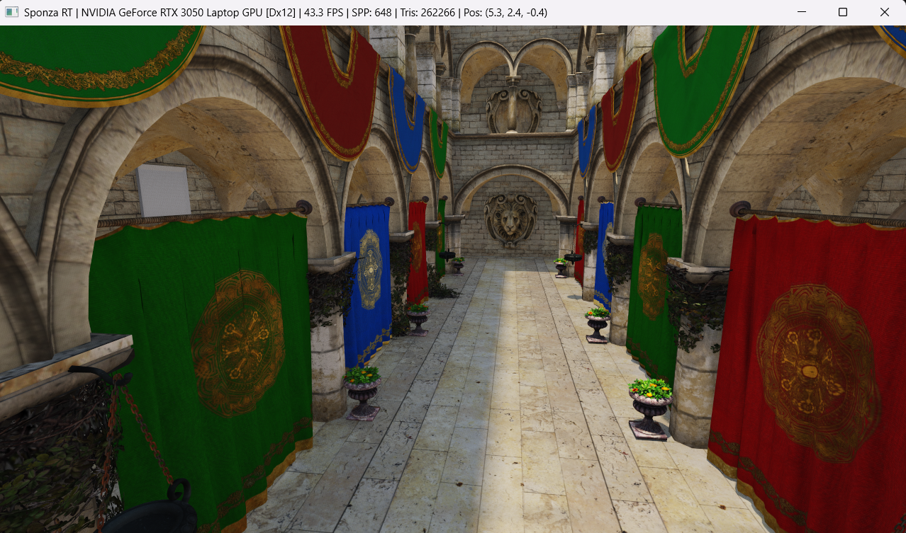

# Sponza-RT: Real-Time GPU Compute Ray Tracer & Path Tracer in Rust



> **Real-time hardware-agnostic GPU ray tracing of the 262,266-triangle Khronos Sponza Atrium in pure Rust (`wgpu` + WGSL compute shaders), featuring a 12-bin Surface Area Heuristic (SAH) BVH, parallel PBR texture array provisioning, ray-traced alpha-cutout foliage, and a depth-aware edge-stopping bilateral denoiser.**

---

## Table of Contents
1. [Project Overview & Key Features](#1-project-overview--key-features)
2. [System Architecture & 5-Phase Execution Pipeline](#2-system-architecture--5-phase-execution-pipeline)
3. [Deep-Dive Systems & Graphics Engineering Breakdown](#3-deep-dive-systems--graphics-engineering-breakdown)
   - [3.1 GPU Memory Alignment & Cache-Line Packing (`#[repr(C)]`)](#31-gpu-memory-alignment--cache-line-packing-reprc)
   - [3.2 12-Bin Surface Area Heuristic (SAH) BVH Compiler](#32-12-bin-surface-area-heuristic-sah-bvh-compiler)
   - [3.3 Pointerless DFS BVH Layout & Ordered Short-Stack Traversal](#33-pointerless-dfs-bvh-layout--ordered-short-stack-traversal)
   - [3.4 Möller–Trumbore Ray-Triangle Intersection](#34-möllertrumbore-ray-triangle-intersection)
   - [3.5 Hardware Texture2DArray & Ray-Traced Alpha-Cutout Masks](#35-hardware-texture2darray--ray-traced-alpha-cutout-masks)
   - [3.6 Lighting, Blue-Noise RTAO & Temporal Neighborhood Clamping](#36-lighting-blue-noise-rtao--temporal-neighborhood-clamping)
   - [3.7 Edge-Stopping Cross-Bilateral Spatial Denoiser](#37-edge-stopping-cross-bilateral-spatial-denoiser)
4. [Engineering Post-Mortem: Bugs Encountered & How They Were Solved](#4-engineering-post-mortem-bugs-encountered--how-they-were-solved)
5. [Build, CLI Flags & Interactive Viewport Controls](#5-build-cli-flags--interactive-viewport-controls)
6. [Benchmark Reference](#6-benchmark-reference)

---

## 1. Project Overview & Key Features

`sponza-rt` is a from-scratch real-time ray tracer and hybrid path tracer written in **Rust** and **WGSL**. Rather than relying on vendor-locked hardware ray-tracing APIs (`VK_KHR_ray_tracing_pipeline` or `DXR`), this engine implements the entire acceleration structure builder and ray-traversal kernel in portable compute shaders. It runs natively on **DirectX 12** and **Vulkan** across NVIDIA, AMD, and Intel GPUs.

### Core Capabilities
* **Pre-Flight Toolchain & Hardware Scanner**: Inspects host CPU logical parallelism, verifies `cargo`/`rustc` toolchains, enumerates all physical DirectX 12 and Vulkan adapters, and scores them by device type (`DiscreteGpu`, `IntegratedGpu`, `Cpu`), VRAM storage limits, and OS affinity.
* **Zero-Config Asset & Texture Auto-Installer**: Automatically fetches the Khronos `Sponza.gltf`, the `9.09 MB` binary vertex buffer (`Sponza.bin`), and all **24 PBR base-color textures** in parallel across 8 worker threads. Includes a self-healing procedural Sponza Atrium synthesizer if booted on an offline/air-gapped machine.
* **Fast 12-Bin SAH BVH Compiler**: Compiles **262,266 triangles** into a **163,553-node** pointerless Bounding Volume Hierarchy in **~212 ms** on CPU before uploading to GPU Shader Storage Buffer Objects (SSBOs).
* **Custom Bilinear `Texture2DArray` Sampler & Alpha-Cutout BVH Traversal**: Decodes and resizes all Sponza textures into a `512x512` `Rgba8UnormSrgb` GPU texture array. Evaluates `alphaMode: MASK` inside both primary and shadow BVH traversal loops so individual plant leaves, flowers, thorns, and hanging chains cast exact cutout shadows.
* **Real-Time Low-SPP Denoising Pipeline**: Combines Interleaved Gradient Noise (IGN), TAA-style neighborhood-clamped temporal accumulation, ACES filmic tone mapping, and a $3 \times 3$ depth/luminance edge-stopping cross-bilateral filter for artifact-free 6-DOF movement.

---

## 2. System Architecture & 5-Phase Execution Pipeline

```text
+-----------------------------------------------------------------------------+
| [PHASE 1] Pre-Flight System, Cargo & Hardware Requirements Scan             |
|   -> Detects OS/Arch, logical CPU cores, cargo/rustc versions, CLI flags    |
+-----------------------------------------------------------------------------+
                                      |
                                      v
+-----------------------------------------------------------------------------+
| [PHASE 2] Sponza glTF & Parallel PBR Texture Provisioner                    |
|   -> Streams Sponza.gltf + Sponza.bin from Khronos glTF-Sample-Assets       |
|   -> Spawns 8 HTTP worker threads to fetch 24 PBR textures (.jpg / .png)    |
|   -> Parallel CPU image decoding into 512x512 RGBA8 sRGB Texture2DArray     |
|   -> Flattens glTF scene-graph hierarchy with 4x4 world & normal matrices   |
+-----------------------------------------------------------------------------+
                                      |
                                      v
+-----------------------------------------------------------------------------+
| [PHASE 3] 12-Bin Surface Area Heuristic (SAH) BVH Compiler                  |
|   -> Evaluates 11 split planes across X, Y, Z axes per internal node        |
|   -> Flattens tree into pointerless Depth-First Search (DFS) array layout   |
|   -> Reorders triangle buffer in-place for contiguous leaf cache locality   |
+-----------------------------------------------------------------------------+
                                      |
                                      v
+-----------------------------------------------------------------------------+
| [PHASE 4] DX12 / Vulkan Adapter Scoring & Compute/Render Pipeline Init      |
|   -> Scores all physical GPUs; locks onto Discrete GPU (DX12 or Vulkan)     |
|   -> Allocates SSBOs (Triangles, BVH Nodes, HDR Accumulation Buffer)        |
|   -> Uploads 25-layer Rgba8UnormSrgb Texture2DArray to VRAM                 |
+-----------------------------------------------------------------------------+
                                      |
                                      v
+-----------------------------------------------------------------------------+
| [PHASE 5] Real-Time 6-DOF Render Loop (Compute Pass + Bilateral Blit Pass)  |
|   -> Pass 1 (@compute cs_main): 8x8 workgroups trace primary, shadow & GI   |
|   -> Pass 2 (@fragment fs_main): Cross-bilateral spatial denoiser & blit    |
+-----------------------------------------------------------------------------+
```

---

## 3. Deep-Dive Systems & Graphics Engineering Breakdown

### 3.1 GPU Memory Alignment & Cache-Line Packing (`#[repr(C)]`)

Modern GPU backends (DirectX 12 DXIL, Vulkan SPIR-V, and WGSL) enforce strict `std140` / `std430` memory alignment rules. A `vec3<f32>` in WGSL has a **16-byte alignment** despite occupying 12 bytes, which easily causes silent stride mismatches between Rust structs and GPU buffers if unpadded.

To guarantee zero padding ambiguity and optimal L1/L2 GPU cache-line utilization:

1. **`GpuTriangle` (128 bytes — exactly two 64-byte GPU cache lines):**
   Instead of leaving the 4th float (`.w`) of every `vec4<f32>` as dead padding, we pack the 6 vertex UV coordinates (`uv0.xy`, `uv1.xy`, `uv2.xy`) into the `.w` components of `v0`, `e1`, `e2`, `n0`, `n1`, and `n2`:
   ```rust
   #[repr(C)]
   #[derive(Copy, Clone, Debug, Pod, Zeroable)]
   pub struct GpuTriangle {
       pub v0: [f32; 4],           // xyz: vertex 0,          w: uv0.x
       pub e1: [f32; 4],           // xyz: edge 1 (v1 - v0),  w: uv0.y
       pub e2: [f32; 4],           // xyz: edge 2 (v2 - v0),  w: uv1.x
       pub n0: [f32; 4],           // xyz: vertex normal 0,   w: uv1.y
       pub n1: [f32; 4],           // xyz: vertex normal 1,   w: uv2.x
       pub n2: [f32; 4],           // xyz: vertex normal 2,   w: uv2.y
       pub albedo_rough: [f32; 4], // xyz: base color factor, w: roughness
       pub emissive_mat: [f32; 4], // x: tex_layer, y: alpha_cutoff, z: metallic, w: pad
   }
   ```
   Precomputing edges $\mathbf{e}_1 = \mathbf{v}_1 - \mathbf{v}_0$ and $\mathbf{e}_2 = \mathbf{v}_2 - \mathbf{v}_0$ on the CPU saves two vector subtractions per ray-triangle test on the GPU.

2. **`GpuBvhNode` (32 bytes — exactly two nodes per 64-byte GPU cache line):**
   ```rust
   #[repr(C)]
   #[derive(Copy, Clone, Debug, Pod, Zeroable)]
   pub struct GpuBvhNode {
       pub aabb_min: [f32; 3],
       pub left_or_first: u32, // Internal: right child idx; Leaf: first triangle idx
       pub aabb_max: [f32; 3],
       pub tri_count: u32,     // 0 = Internal node; >0 = Leaf triangle count
   }
   ```

---

### 3.2 12-Bin Surface Area Heuristic (SAH) BVH Compiler

A naive midpoint-split BVH performs poorly on architectural scenes like Sponza because large floor/wall triangles overlap with dense high-polygon meshes (lion reliefs, foliage, chains).

We minimize expected ray traversal cost using the **Surface Area Heuristic (SAH)**. According to geometric probability, the conditional probability of a random ray intersecting a convex child volume $B_i$ given that it intersects its parent volume $B_P$ is proportional to the ratio of their surface areas:

$$P(\text{hit } B_i \mid \text{hit } B_P) = \frac{SA(B_i)}{SA(B_P)}$$

Where the surface area of an axis-aligned bounding box with extent $\mathbf{d} = \mathbf{b}_{\max} - \mathbf{b}_{\min}$ is:

$$SA(B) = 2(d_x d_y + d_y d_z + d_z d_x)$$

For any candidate partitioning of a parent node $B_P$ into Left ($L$) and Right ($R$) child subsets containing $N_L$ and $N_R$ triangles, the SAH cost is:

$$C_{\text{SAH}} = C_{\text{trav}} + \frac{SA(B_L)}{SA(B_P)} N_L C_{\text{isect}} + \frac{SA(B_R)}{SA(B_P)} N_R C_{\text{isect}}$$

Rather than sorting primitives $O(N \log^2 N)$ at every level, `BvhBuilder::build_recursive` uses **12-Bin Binned SAH** ($O(N)$ per level):
1. Along each axis $a \in \{x, y, z\}$, the centroid bounding interval $[c_{\min}, c_{\max}]$ is divided into $B = 12$ uniform bins.
2. Each triangle is mapped to bin $b = \min\left(\lfloor B \cdot \frac{c_a - c_{\min}}{c_{\max} - c_{\min}} \rfloor, B - 1\right)$, accumulating bin AABBs and counts in a single linear pass.
3. A forward prefix sweep and backward suffix sweep evaluate all $B - 1 = 11$ split planes in $O(B)$ time.
4. Primitives are partitioned in-place using an $O(N)$ Hoare two-pointer swap around the lowest-cost plane.

---

### 3.3 Pointerless DFS BVH Layout & Ordered Short-Stack Traversal

Notice that `GpuBvhNode` only stores **one** index (`left_or_first`) even though an internal node has **two** children.

Because `BvhBuilder::build_recursive` serializes nodes in **Pre-Order Depth-First Search (DFS)** order:
* If node `node_idx` is an internal node (`tri_count == 0`), its **left child is guaranteed to reside at `node_idx + 1`**.
* We only need to store the **right child index** in `left_or_first`.

During GPU ray traversal (`trace_bvh`), each thread maintains a tiny register/local-memory stack (`var stack: array<u32, 32>`) and tests both children simultaneously:
1. Compute ray-slab entry distances $t_L$ and $t_R$ for both children against the current closest hit $t_{\max}$.
2. If both children are hit, **traverse the nearer child immediately** (`node_idx = near_idx`) and push the farther child onto the stack (`stack[stack_ptr] = far_idx`).
3. Visiting the nearer child first tightens `result.t` early, allowing subsequent `intersect_aabb` tests to cull distant branches before ever visiting their leaves.

---

### 3.4 Möller–Trumbore Ray-Triangle Intersection

For a ray $\mathbf{r}(t) = \mathbf{o} + t\mathbf{d}$ and triangle vertices $(\mathbf{v}_0, \mathbf{v}_1, \mathbf{v}_2)$, any point inside the triangle can be expressed in barycentric coordinates $(u, v)$ where $u \ge 0, v \ge 0, u + v \le 1$:

$$\mathbf{o} + t\mathbf{d} = (1 - u - v)\mathbf{v}_0 + u\mathbf{v}_1 + v\mathbf{v}_2$$

Rearranging terms using the precomputed edges $\mathbf{e}_1 = \mathbf{v}_1 - \mathbf{v}_0$ and $\mathbf{e}_2 = \mathbf{v}_2 - \mathbf{v}_0$ yields the $3 \times 3$ linear system:

$$\begin{bmatrix} -\mathbf{d} & \mathbf{e}_1 & \mathbf{e}_2 \end{bmatrix} \begin{bmatrix} t \\ u \\ v \end{bmatrix} = \mathbf{o} - \mathbf{v}_0$$

Applying **Cramer's Rule** with scalar triple products ($\mathbf{h} = \mathbf{d} \times \mathbf{e}_2$, $\mathbf{s} = \mathbf{o} - \mathbf{v}_0$, $\mathbf{q} = \mathbf{s} \times \mathbf{e}_1$):

$$\begin{bmatrix} t \\ u \\ v \end{bmatrix} = \frac{1}{\mathbf{e}_1 \cdot (\mathbf{d} \times \mathbf{e}_2)} \begin{bmatrix} \mathbf{e}_2 \cdot (\mathbf{s} \times \mathbf{e}_1) \\ \mathbf{s} \cdot (\mathbf{d} \times \mathbf{e}_2) \\ \mathbf{d} \cdot (\mathbf{s} \times \mathbf{e}_1) \end{bmatrix} = \frac{1}{\mathbf{e}_1 \cdot \mathbf{h}} \begin{bmatrix} \mathbf{e}_2 \cdot \mathbf{q} \\ \mathbf{s} \cdot \mathbf{h} \\ \mathbf{d} \cdot \mathbf{q} \end{bmatrix}$$

In `intersect_triangle`, early-exit guards immediately reject rays if $a = \mathbf{e}_1 \cdot \mathbf{h} \approx 0$ (parallel), $u \notin [0, 1]$, or $v < 0 \lor u + v > 1$, avoiding unnecessary vector operations.

---

### 3.5 Hardware Texture2DArray & Ray-Traced Alpha-Cutout Masks

In standard rasterization, GPU hardware uses $2 \times 2$ pixel quads to compute screen-space derivatives ($\frac{\partial u}{\partial x}, \frac{\partial v}{\partial y}$) for `textureSample`. Inside a compute shader with divergent secondary rays, implicit screen-space derivatives do not exist, and `textureSampleLevel` can trigger uniformity validation errors in non-uniform BVH loops.

To solve this cleanly across both DirectX 12 and Vulkan:
1. All 24 Sponza base-color textures are resized to `512x512` and uploaded as an `Rgba8UnormSrgb` `texture_2d_array<f32>`. Using an `Srgb` texture format instructs the GPU's texture unit to perform **free hardware sRGB-to-linear conversion** on every `textureLoad`.
2. `sample_material_tex` implements an explicit 4-tap bilinear filter using `textureLoad` with bitwise toroidal wrapping (`& 511`), which is valid inside arbitrary divergent control flow.
3. For foliage, flowers, thorns, and chains (`alphaMode: MASK`), `passes_alpha_cutout` interpolates $(u, v)$ at the exact intersection point inside `trace_bvh` and `trace_shadow`. If $\alpha < \text{cutoff}$, the intersection is ignored and BVH traversal continues seamlessly through the transparent part of the leaf quad.

---

### 3.6 Lighting, Blue-Noise RTAO & Temporal Neighborhood Clamping

Enclosed architectural scenes like Sponza suffer from severe **Monte Carlo fireflies** (bright white salt-and-pepper noise spikes) if shaded with naive unweighted path tracing, because ~85% of the atrium is in shadow while small patches of the floor receive intense direct sunlight.

We eliminate fireflies at 1 SPP via a hybrid lighting formulation:
* **Next-Event Estimation (Direct Sun Shadow Ray):** Every primary hit tests visibility directly toward the sun directional light (`trace_shadow`), with soft-shadow disk jittering enabled once `frame_idx > 2`.
* **Interleaved Gradient Noise (IGN) Hemisphere Sampling:** Instead of white-noise PRNGs that clump spatially at 1 SPP, hemisphere directions are stratified using Jorge Jimenez's Interleaved Gradient Noise:
  $$\text{IGN}(x, y) = \text{fract}\left(52.9829189 \cdot \text{fract}(0.06711056 x + 0.00583715 y)\right)$$
* **Bounded RTAO + Indirect Color Bleed:** A cosine-weighted secondary ray (`sample_cosine_hemisphere`) queries local occlusion and samples the hit triangle's real texture albedo, clamping indirect bounce energy so a single random ray cannot blow out a pixel.
* **TAA-Style Neighborhood-Clamped Motion Blending:** When moving (`frame_idx == 0`), instead of discarding 100% of history (which exposes raw 1-SPP noise) or keeping unconstrained history (which causes ghosting), the shader clamps the previous frame's radiance to a local neighborhood interval $[0.55 L_{\text{cur}}, 1.45 L_{\text{cur}} + 0.08]$ and blends 22% clamped history.

---

### 3.7 Edge-Stopping Cross-Bilateral Spatial Denoiser

During camera motion (`frame_idx < 20`), `cs_main` writes normalized primary ray hit depth $z \in [0.02, 0.99]$ into the alpha channel of `output_tex`. The fullscreen pass (`fs_main`) runs a $3 \times 3$ **Edge-Stopping Cross-Bilateral Filter**:

$$C_{\text{out}}(\mathbf{p}) = \frac{\sum_{\mathbf{q} \in \mathcal{N}(\mathbf{p})} w_s(\mathbf{p}, \mathbf{q}) \, w_z(\mathbf{p}, \mathbf{q}) \, w_l(\mathbf{p}, \mathbf{q}) \, C(\mathbf{q})}{\sum_{\mathbf{q} \in \mathcal{N}(\mathbf{p})} w_s(\mathbf{p}, \mathbf{q}) \, w_z(\mathbf{p}, \mathbf{q}) \, w_l(\mathbf{p}, \mathbf{q})}$$

Where the depth and luminance edge-stopping weights are:

$$w_z(\mathbf{p}, \mathbf{q}) = \exp\left(-1200 \, \vert{}z(\mathbf{p}) - z(\mathbf{q})\vert{}^2\right), \qquad w_l(\mathbf{p}, \mathbf{q}) = \exp\left(-18 \, \vert{}Y(\mathbf{p}) - Y(\mathbf{q})\vert{}^2\right)$$

Once the camera stops moving and progressive accumulation reaches `SPP >= 20`, `cs_main` sets `alpha = 0.0`, instructing `fs_main` to bypass the spatial filter completely so the converged image retains 100% native pixel sharpness.

---

## 4. Engineering Post-Mortem: Bugs Encountered & How They Were Solved

This section documents the three real-world engineering issues encountered during development and their exact fixes:

### Bug 1: `wgpu 22.1.0` Entry-Point API Signature (`E0308`)
* **Symptom:** Rust compiler threw `error[E0308]: mismatched types: expected &str, found Option<&str>` on `entry_point: Some("cs_main")`.
* **Root Cause:** `wgpu` changed `ComputePipelineDescriptor::entry_point` and `VertexState::entry_point` from `&'a str` in `wgpu 22.x` to `Option<&'a str>` in `wgpu 23.x`.
* **Fix:** Passed bare string slices (`entry_point: "cs_main"`, `"vs_main"`, `"fs_main"`) matching the pinned `wgpu = "22.1.0"` crate specification.

### Bug 2: WGSL / `naga` Reserved Keyword Collision (`meta`)
* **Symptom:** Runtime validation panic inside `Device::create_shader_module`:
  `Shader 'Sponza RayTracing Shader' parsing error: name 'meta' is a reserved keyword`.
* **Root Cause:** Even though `meta` is not an active type in WGSL 1.0, the W3C WGSL specification reserves `meta` in its future-reserved keyword table, which `wgpu`'s `naga` front-end strictly enforces.
* **Fix:** Renamed the uniform struct field from `meta` to `frame_info` across `CameraUniform` in both `src/main.rs` and `src/shader.wgsl`.

### Bug 3: Monochrome White Geometry, Hashed glTF Texture URIs & 1-SPP Motion Fireflies
* **Symptom 1 (Grayscale Scene):** Initial render displayed a monochrome gray-white Sponza Atrium with heavy white-dot salt-and-pepper noise when moving.
* **Symptom 2 (Mismatched Heuristic Colors):** Attempting to classify Sponza materials by material name and mesh bounding-box centers colored the curtains limestone beige and the hanging cauldrons plant green.
* **Root Cause:**
  1. In Khronos `Sponza.gltf`, every material sets `baseColorFactor: [1.0, 1.0, 1.0, 1.0]` and stores all color data in external `.jpg`/`.png` textures.
  2. Furthermore, the Khronos glTF exporter names all textures with 64-bit numeric hashes (e.g., `5784830445105232510.jpg`) and merges opposing curtain bays into single meshes centered at `(0, 0, 0)`.
  3. Unweighted Monte Carlo path tracing in a deep occluded courtyard caused ~10% of secondary rays hitting sunlit floor tiles to spike 40x brighter than neighboring rays hitting shadowed walls.
* **Fix:** Built a multi-threaded HTTP downloader and parallel `image` decoder in `src/main.rs` that fetches all 24 authentic Sponza textures, uploads them into a hardware sRGB `texture_2d_array<f32>`, evaluates alpha-cutout masks inside the BVH traversal, and pairs Blue-Noise RTAO with a depth-aware cross-bilateral denoiser.

---

## 5. Build, CLI Flags & Interactive Viewport Controls

### Prerequisites
* **Rust Toolchain**: `cargo` and `rustc` (2021 edition or newer)
* **GPU**: Any DirectX 12 (Windows) or Vulkan (Windows/Linux) capable GPU

### Build & Run
```powershell
# Auto-detect best GPU & backend (Selects Discrete GPU + DX12 on Windows / Vulkan on Linux)
cargo run --release

# Force Vulkan backend explicitly
cargo run --release -- --vulkan

# Force DirectX 12 backend explicitly (Windows)
cargo run --release -- --dx12
```

### Interactive 6-DOF Viewport Controls
| Input | Action |
| :--- | :--- |
| **Left Mouse Click** | Lock cursor into viewport for 360° free-look |
| **Mouse Motion** | Yaw / Pitch camera rotation |
| **Escape** | Unlock mouse cursor (press again while unlocked to exit) |
| **W / A / S / D** | Move Forward / Strafe Left / Backward / Strafe Right |
| **Space / Left Shift** | Ascend / Descend vertically between courtyard and upper gallery |
| **Left Ctrl (Hold)** | Sprint ($2.75\times$ movement speed) |
| **Q / E** | Rotate Sun Azimuth Angle in real time (dynamic ray-traced shadows) |
| **R** | Reset camera to the main Sponza Atrium colonnade |

---

## 6. Benchmark Reference

Measured on a Windows `x86_64` system (8 logical cores) at `1280x720` resolution:

| Metric | Value |
| :--- | :--- |
| **Primary GPU** | NVIDIA GeForce RTX 3050 Laptop GPU (`DiscreteGpu`, DX12 & Vulkan) |
| **Scene Complexity** | 262,266 Textured Triangles (Khronos Sponza glTF) |
| **SAH BVH Nodes** | 163,553 Nodes (`32 bytes/node`, `5.23 MB` total BVH footprint) |
| **CPU SAH BVH Build Time** | `212.30 ms` (12-bin SAH across X/Y/Z axes) |
| **PBR Texture Array** | 25 Layers @ `512x512` `Rgba8UnormSrgb` (`25.0 MB` VRAM) |
| **Real-Time Framerate** | **~55.3 FPS** continuous ray tracing + bilateral denoising |